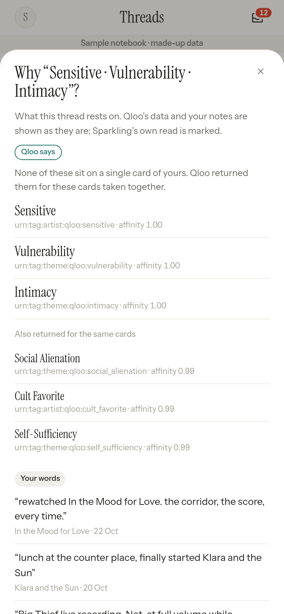

# Sparkling

**Keep the things that stay with you.**

Sparkling is a notebook for people who love films, music, books and places. You write a line, paste a link or drop a screenshot, the way you already do in your notes app. Sparkling quietly recognises the cultural things you mention, keeps **one card per thing** with a dated trail of every time it came back to you, and, when you ask, turns the cards you return to into a **real two-stop weekend plan** near you.

Built for the Qloo Hackathon. Every card and every plan stop is a real entity returned by [Qloo's Taste AI](https://www.qloo.com/) in that session; the language model only reads notes and writes short copy. It never invents a title, an artist or a place.



## How it works

1. **Capture** – a note is saved before anything else runs. Nothing is ever asked at capture time.
2. **Recognise** – a small model lists the named films, shows, artists, books and venues in the note (exact words only). Each mention is resolved with Qloo `/search`.
   - Sure matches become a *footprint* on the entity's card (rewatch, listen, read, visit, quote…, with the sentiment of that note).
   - Unsure matches wait in a red-dot inbox. An unreviewed guess never reaches a card or a plan.
   - Songs and albums are saved under their artist, only when the note names the artist.
   - Corrections ("Not about this", "Not a thing") are remembered per user.
3. **Cards** – a calm wall, one card per Qloo entity, sized by attention (how often it comes back, with recency decay). Card detail shows every footprint in the user's own words, a "your view changed" pair when two notes disagree, and up to three tags labelled as Qloo's catalogue data.
4. **Threads** – Qloo tags shared by heavy, liked cards across at least two domains.
5. **Weekend plan** – seeds are the cards you love or return to (never ones you mostly disliked). Sparkling asks Qloo `/v2/insights` for places near your area for each stop you want (`filter.tags` from `/v2/tags`, `signal.interests.entities` from your seeds), widens the search honestly when the area is thin, drops places you already know or that are over budget, and keeps stops walkable. Each stop carries three labelled reasons: **From your notes**, **From Qloo**, **Sparkling's read**, plus an operational line ("Hours not checked"). Swap, Shorten and Lower budget re-rank the same Qloo pool.
6. **Did you go?** – after a saved plan, one quiet row asks. "Yes, add a line" turns the visit into a note and a footprint on the place card. The loop closes.

## Stack

- Cloudflare Workers (single Worker, no framework), D1 (SQLite), R2 or KV for photos
- Workers AI: Llama 3.3 70B for mention extraction and copy, Llama 4 Scout for reading text in photos
- Qloo Taste AI REST API: `/search`, `/entities`, `/v2/insights`, `/v2/tags`
- Front end: one vanilla HTML/JS file, mobile first. A small inline motion layer (WebGL1 liquid gradient and paper-strata headers, word reveal, morphing tab bar, swipe deck, slide to confirm) with no libraries; it pauses offscreen and respects `prefers-reduced-motion`

## Run it yourself

```bash
npm install
npx wrangler d1 create sparkling-db         # put the id in wrangler.toml
npx wrangler d1 execute sparkling-db --remote --file=schema.sql
npx wrangler r2 bucket create sparkling-media   # or use the KV block in wrangler.toml
npx wrangler secret put QLOO_API_KEY
npx wrangler deploy
```

## Privacy

Your notes and photos never go to Qloo. Recognition sends only the short mention text to Qloo search; planning sends the IDs of a few cards and your area. Export everything as one file, or delete everything, from Settings.

The sample notebook ("Juno Park") is fictional and written by hand; it stores only our own text and Qloo entity IDs. No Qloo responses are stored in this repository.

## License

MIT © Q1f730

## Credits

The r6 motion layer's look (liquid cursor gradient, layered paper waves, fluid orb, morphing tab, slide to confirm, card deck) was inspired by [RewampUI](https://www.rewampui.com) by palakonweb. RewampUI's repository has no license, so no code was copied: Sparkling's versions are original vanilla JS/CSS/GLSL written for this app, in its own warm paper palette.

## Tests

Run the unit tests (Letterboxd parser, Then/Now cohorts, plan notice):

    node --test tests/unit.test.mjs
