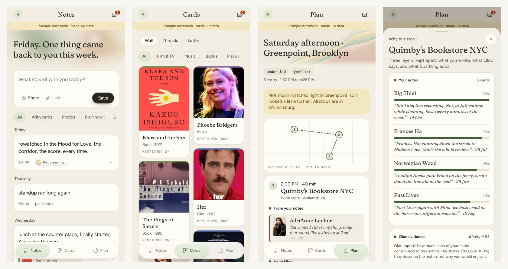
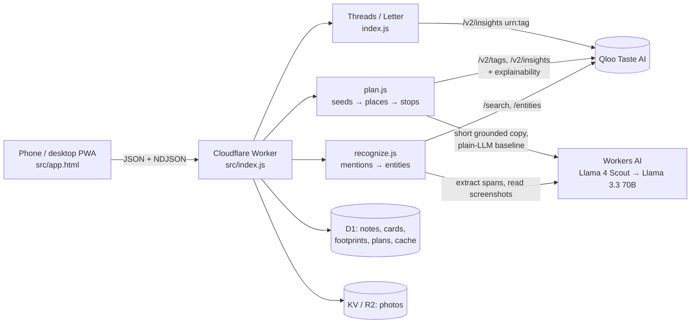

# Sparkling

**A notebook that turns the culture you keep coming back to into a real, explainable Saturday.**

Write a line about a film, a song, a book or a shop, the way you already do in your notes app. Sparkling quietly resolves what you mentioned to real [Qloo](https://www.qloo.com/) entities, keeps **one card per thing** with a dated trail of every time it came back to you, and, when you ask, turns the cards you love into a **three-stop plan of real places nearby**, with a receipt for every stop.

**Live demo → https://sparkling-dev.q1f0730.workers.dev** (tap *Try a sample notebook*; fictional New York persona, no signup)



Built for the Qloo Agentic Hackathon ("Agents, but with taste"). Every card and every plan stop is an entity Qloo returned in that session. The language model only reads notes and writes short copy; it never invents a title, an artist or a place.

## What it does

| | |
|---|---|
| **Capture** | One post box plus a camera for screenshots. The note is saved first; nothing is asked at capture time. |
| **Cards** | Each named film, show, artist, book or venue becomes one card. Later mentions become dated footprints in your own words; "your view changed" appears when two notes disagree. |
| **Inbox** | Unsure matches wait in a swipe deck (right = yes, left = not a thing). An unreviewed guess never reaches a card or a plan. |
| **Threads** | Qloo tags that connect your cards. *Why this thread?* shows the exact tags and affinity, your quotes and the call receipt. Then/Now compares recent and earlier cards (Sparkling's logic, not Qloo tracking a person). |
| **Go live it** | "Saturday afternoon · Greenpoint · under $40" → bookstore, cafe, record store with arrive times, walk/bike legs, a schematic route and Qloo-listed hours marked *not live-checked*. Thin area? It widens and says so. |
| **Why this stop?** | Three layers kept apart: **Your notes** (cards Qloo credited, with contribution share and the dated note), **From Qloo** (affinity, tags, description), **Sparkling's read** (grounded in those fields). |
| **How this was made** | Numbered agent trace with timings and Qloo calls. Swap, Shorten and Lower budget re-rank the same Qloo pool. |
| **Plain LLM** | Same model, same seeds and area, no Qloo, side by side. Its names are shown as unverified. |
| **Close the loop** | "Did you go?" turns a visited stop into a note and a footprint on the place's card. |
| **Also** | Monthly taste letter (no model call), Letterboxd CSV import, English / 简体中文, Light / Paper / System-dark, export (JSON, Markdown), delete everything, installable PWA. |


## How Qloo is used

Qloo is the only source of entities, tags and places. All calls go from the Worker to the hackathon host with a timeout.

| Step | Endpoint and key parameters | Used for |
|---|---|---|
| Recognise | `GET /search` `query`, `types` | Mention → `entity_id`. "Sure" only for an exact-title hit of the expected type with no similarly popular rival; otherwise → inbox. |
| Card details | `GET /entities` `entity_ids` | Poster, year, creator, tags. |
| Threads | `GET /v2/insights` `filter.type=urn:tag`, `signal.interests.entities` | Tags shared across your cards, with affinity. |
| Stop category | `GET /v2/tags` `filter.query`, `filter.parents.types=urn:entity:place` | e.g. `urn:tag:category:place:book_store`. |
| Places | `GET /v2/insights` `filter.type=urn:entity:place`, `filter.tags`, `filter.location.query`, `signal.interests.entities`, `feature.explainability=true` | Candidates with `query.affinity` and per-seed contribution scores for *Why this stop?* |
| Widening | same, with `filter.location=POINT(lon lat)` + `filter.location.radius=3200`, then the borough | Only when the area is thin; the plan says so. |
| Hours | `properties.hours`, `is_closed` | "Qloo lists Saturday 11:00–20:00 · not live-checked"; closed places dropped. |

Explainability is shown as a *contribution share*, never as a probability or a cause. Qloo never sees a note: search gets only the short name being looked up, and every other call gets only entity IDs, tag IDs and a neighbourhood.

## Architecture



- The note is stored before recognition runs (`ctx.waitUntil`); failed recognitions retry up to 3 times.
- Model output is cached in D1; when the Workers AI quota runs out, a rule-based extractor and a 5-minute circuit breaker keep the app working.
- The plan streams its trace as NDJSON while it works. More detail: [docs/ARCHITECTURE.md](docs/ARCHITECTURE.md).

## Run it yourself

Requires Node 18+, a Cloudflare account and a Qloo API key.

```bash
npm install
npx wrangler d1 create sparkling-db            # put the id in wrangler.toml
npx wrangler d1 execute sparkling-db --remote --file=schema.sql
npx wrangler r2 bucket create sparkling-media  # or use the KV block in wrangler.toml
npx wrangler secret put QLOO_API_KEY
npx wrangler deploy
```

Local dev: `npx wrangler dev`. Workers AI is bound as `AI` in `wrangler.toml`.

## Tests

```bash
node --test tests/unit.test.mjs        # Letterboxd parser, Then/Now cohorts, plan notice
bash tests/adversarial/run_all.sh      # 11,670 table-driven cases (LIVE=1 adds ~300 live requests)
```

See [tests/adversarial/REPORT.md](tests/adversarial/REPORT.md).

## Privacy

Notes and photos never go to Qloo. Recognition sends only the short mention text to Qloo search; planning sends a few card IDs and your area. Export or delete everything from Settings.

The sample notebook ("Juno Park") is fictional and hand-written; it stores only our own text and Qloo entity IDs. No Qloo responses are stored in this repository.

## Known limits

- Hours come from Qloo and are not live-checked.
- Category results are only as clean as Qloo's tags (e.g. a taproom Qloo tags as a cafe can appear as "Cafe").
- Native wrappers (Capacitor Android/iOS, Electron macOS) build unsigned in CI but are untested on devices; the PWA is the supported path.
- No push notifications are sent yet; only the preferences are stored.

## License

[MIT](LICENSE) © Q1f730

## Credits

- Taste data: [Qloo Taste AI API](https://www.qloo.com/).
- Motion inspiration: the liquid cursor gradient, layered paper waves, fluid orb, morphing tab, slide-to-confirm and card deck were inspired by [RewampUI](https://www.rewampui.com) by palakonweb. RewampUI's repository has no license, so no code was copied: Sparkling's versions are original vanilla JS/CSS/GLSL written for this app, in its own warm paper palette.
- Fonts: Fraunces, Figtree and DM Mono (Google Fonts, SIL Open Font License).
- Runs on Cloudflare Workers, D1 and Workers AI (Meta Llama models).
